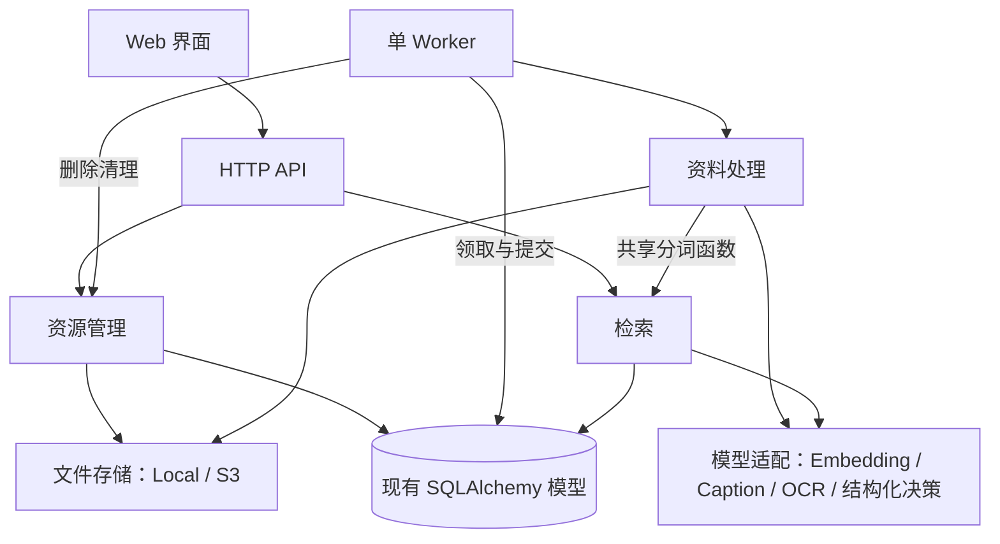

# 数据库之外的模块设计

本文规划 MMKB 首版的业务模块、最小接口、关键流程与开发顺序。以后端为主，前端只确定页面职责和 API 交互边界。数据库字段、约束及迁移规则见 [Schema 说明](schema.md)。

本文描述目标设计，不代表所有能力已交付。资源管理、五条处理路线、单 Worker、真实模型桥接和向量搜索 API 已完成后端闭环，处理与恢复入口见 [处理说明](processing.md)，检索当前范围见 [检索说明](retrieval.md)。Local/S3 存储和显式 profile 初始化入口见 [文件存储说明](storage.md)，RustFS 兼容性仍需通过目标服务的真实契约测试验收。Web、缩略图、关键词增强与对账等后续能力仍以本文为目标设计；运行入口见 [README](../README.md)。

## 1. 总体结构

采用轻量模块化单体：一个 Python 后端代码库，HTTP API 与单 Worker 分别启动，共享业务模块和配置。首版面向单用户，以整份图片、图文或文本资料为单位，先完成“导入 → 编码 → 检索 → 查看原件”的闭环。

沿用现有三张业务表，资源状态承担后台处理调度所需的信息。一份资料只有一条 2048 维半精度向量；首版不增加 Chunking、Embedding Space、任务表、消息队列、历史版本或多 Worker 调度。

业务服务直接使用现有 SQLAlchemy 模型管理事务。首版不另设通用 Repository、事件总线或插件框架。模型与存储适配器不改变资源状态；Web 不直接访问数据库、对象存储或模型服务。

## 2. 五个核心模块

以下名称是后续 Python 模块的建议名称，按实施阶段逐步建立，无需先创建空目录或基类。

| 模块 | 职责 | 最小接口与结果 |
| --- | --- | --- |
| **资源管理 `resources`** | 图片、图文、文本导入；元数据、详情、编辑、重试、删除和原件访问；协调文件保存与数据库提交 | 创建返回资源 ID 与状态；列表和详情返回资料信息；编辑携带 revision；提供逻辑删除、失败重试及删除后清理操作 |
| **资料处理 `processing`** | 五条工作流路由；组织 OCR、Caption、编码和分词；生成待提交结果 | 输入资料快照和 revision，输出解析字段、唯一向量、分词文本及警告；计算过程不自行提交结果 |
| **模型适配 `providers`** | 封装 Embedding、Caption、OCR 与可选结构化决策（`/v1/systemone`）的调用协议、超时和结果校验 | Embedding 接收文本、图片或图文及查询/资料用途，返回统一向量；Caption/OCR 返回文字和可选附加信息；图像路线判断通过可选图像能力提供；决策适配针对一个 state 返回 `choice`/`noul`/`score` 答案的概率与置信度，调用方式见 [决策模型适配](systemone.md) |
| **文件存储 `storage`** | 统一 Local 与 S3 兼容存储；原件读写、文件属性、删除与缩略图缓存 | `put / open / stat / delete`；输入存储配置与相对 key，返回文件属性或可关闭的读取流 |
| **检索 `retrieval`** | 查询编码、向量召回、过滤、排序；共享 Jieba 分词与可选关键词辅助 | 接收文本、图片或图文查询、标签条件和 Top-K，返回资源摘要、得分及实际检索模式；单独提供可复用的分词函数 |

### 2.1 资源管理

当前已实现资源服务与 FastAPI 管理接口，包括三类导入、编辑、失败重试、原件访问及删除清理；运行方式与接口见 [资源管理说明](resources.md)。导入和编辑后先进入 `pending`，由独立 Worker 处理。删除先软删除，再在请求中尝试一次文件清理；失败可用维护命令重试，Worker 每轮也复用同一清理函数。

资源管理负责业务输入校验，包括输入形式、支持的文件格式、大小、工作流兼容性和编辑版本。首版支持 PNG、JPEG、WebP 图片及非空文本。文件 key 由服务端依据资源 ID 生成，客户端不直接指定任意存储路径。

该模块负责资源生命周期的用户操作，不调用模型完成整条处理流程。导入和编辑将资料排入待处理状态；状态查询直接读取资料状态，不另设任务 ID。

### 2.2 资料处理与模型适配

资料处理决定“调用哪些能力、如何组合编码输入”，模型适配只负责“如何请求服务、如何解释响应”。工作流分支复用同一组能力，不按工作流复制模型客户端。

处理结果应携带原资源 ID 与 revision，供 Worker 最终提交时复核。模型调用和文件读取在数据库事务之外进行，避免把网络等待放入持锁事务。

Embedding 适配器统一供资料编码和查询编码使用，保持模型、维度与预处理约定一致，并区分模型要求的查询/资料用途。图文使用服务原生联合输入，不用图片向量与文本向量的平均值代替。

### 2.3 文件存储

Local 与 S3 实现同一接口，S3 适配应覆盖 RustFS。资源记录自己的 storage profile 和文件 key，读取时据此选择后端；切换默认存储只影响新导入资料。

- 每份资料独立拥有原件，SHA-256 用于完整性校验和重复提示，不做共享文件引用计数。
- 存储层校验相对 key 和本地根目录边界，读取流由调用方及时关闭。
- 删除已不存在的对象视为清理成功，便于失败重试。
- 缩略图是可重建缓存，跟随所属资料清理，不增加派生文件表。
- S3 凭证通过服务端配置引用解析，数据库和 API 响应不保存或返回密钥。

### 2.4 检索与共享分词

向量召回是默认路径。Jieba 分词函数由资料处理和关键词查询共享，资料侧组合标题、标签、用户文字、OCR、Caption 后生成 `segmented_text`，查询侧使用相同分词约定。`search_tsv` 继续由数据库生成。

资料处理只复用检索模块中的分词函数，不调用完整查询流程；检索模块不反向依赖 Worker 或工作流路由。

## 3. 入口与共享基础能力

### HTTP API

HTTP API 负责请求解析、响应、错误映射和依赖组装，调用资源管理或检索模块。资源创建返回 ID 与处理状态，不等待完整模型流水线；搜索请求等待本次查询编码和召回完成。

首版接口按能力分组，不在本文固定完整请求响应字段：

| API 能力 | 调用目标 | 主要行为 |
| --- | --- | --- |
| 资料创建、列表、详情 | 资源管理 | 支持三类输入，浏览元数据及处理状态 |
| 编辑、重试、删除 | 资源管理 | 编辑校验 revision，返回明确的状态或冲突错误 |
| 原件与缩略图读取 | 资源管理 → 文件存储 | 检查删除状态，通过应用代理返回文件 |
| 三类输入检索 | 检索 | 返回排序结果与实际使用的检索模式 |
| 连接状态 | 配置与相关适配器 | 展示数据库、模型和存储可用性，不返回凭证 |

### Worker

Worker 是独立启动的单实例后台进程，负责扫描和领取待处理资料、调用资料处理模块、提交结果，以及扫描删除清理任务。当前入口为 `python -m mmkb.worker run`，使用数据库会话级锁保证单实例；模型调用位于业务事务之外。恢复使用显式 `recover-processing` 命令并递增 revision，具体行为见 [处理说明](processing.md)。

资料正常状态流转为 `pending → processing → ready`；处理失败进入 `failed`，用户重试后回到 `pending`。只在确认旧 Worker 已停止后，才将遗留 `processing` 重新排队，不能因请求耗时较长就认定任务已经失效。

### Web

| 页面 | 首版职责 |
| --- | --- |
| 资料列表与检索 | 浏览资料，提交文本、图片、图文查询，按标签过滤并打开详情 |
| 导入 | 上传或粘贴资料，填写配文，通过轮询展示逐项处理状态 |
| 资料详情 | 查看原件、用户文字、Caption、OCR 和标签；编辑、重试、删除 |
| 连接状态 | 展示依赖状态，首版不在线编辑模型和存储部署配置 |

前端只消费 API，不复刻后端路由、编码或状态流转逻辑。具体组件、状态管理和页面实现另行设计。

### 配置、初始化与日志

沿用 [配置加载器](../mmkb/config.py) 的环境变量优先规则：进程环境优先于 `.env.local`。检索配置先保存在代码与环境变量中，不增加配置表。

API 和 Worker 的启动入口负责组装配置、模型客户端及存储适配器。运维初始化入口负责创建或选择可用 storage profile，应用启动不隐式修改已存在的存储配置。结构变更继续通过 Alembic 管理。

日志记录资源 ID、revision、阶段、耗时和错误类型。用户可见错误提供可操作原因，内部日志避免记录凭证、完整用户内容或完整模型请求体。

本文不包含具体服务地址、模型部署标识、Bucket、个人路径或凭证；这些内容留在部署配置与内部文档。后续开发、依赖安装、迁移和测试统一使用 `mmkb` Conda 环境，入口命令见 [README](../README.md)。

## 4. 核心数据流

### 4.1 导入与处理

1. 资源管理校验输入并生成资源 ID。图片先保存原件、计算 SHA-256，再创建 `pending` 资料；纯文本直接写入资料记录。相同内容允许作为独立资料导入，同时给出重复提示。
2. 文件已保存而数据库提交失败时，补偿删除本次文件；未清理成功的遗留对象由后续对账处理。数据库与文件存储之间不假定存在跨系统事务。
3. Worker 在短事务内领取资料，记录 revision 并设置 `processing`，随后在事务外读取文件、选择工作流并调用模型。
4. 资料处理生成解析字段、唯一向量和分词文本。OCR 原文、Caption、用户文字分别保存，不相互覆盖。
5. Worker 在短事务中重新检查 revision、处理状态与删除标记；只有仍属于当前处理版本时，才原子提交解析结果、索引和 `ready` 状态。过期结果丢弃。

五条工作流共用上述流程：

当前实现按路线调用：图表执行结构化 Caption，普通图片执行普通 Caption，文档图片执行 OCR，图文与纯文本不额外调用视觉增强。下表的“按需”辅助能力保留为后续扩展，不代表首轮全部执行。

| 工作流 | 唯一向量的编码输入 | 辅助能力 |
| --- | --- | --- |
| `structured_image`：图表与结构化图片 | 整图与 Caption 联合编码 | 描述关系、结构和趋势；Caption 失败回退整图，按需 OCR |
| `visual_image`：视觉描述型图片 | 整图 | 可选 Caption，用于展示和关键词辅助 |
| `visdoc`：文本密集图片 | 整图 | OCR 提取文字并保留原图，不承诺块级检索 |
| `text_image`：图片与配文 | 整图与用户配文联合编码 | 按需复用 OCR/Caption |
| `text`：纯文本 | 整份用户文字 | 直接分词，不调用 OCR/Caption |

输入形式先确定纯文本与图文路线；仅图片输入通过可选图像判断区分前三条，判断不可用时回退 `visual_image` 并记录警告。素材类别通过标签表达，不扩展为十套独立工作流。

Embedding 结果必须为 2048 维、有限数值且非零，经适配器校验并归一化后交给写入流程。超出模型输入限制时明确报告，不自动分块或静默截断。

### 4.2 编辑、失败与删除

- 编辑时校验客户端 revision，增加 revision 和更新时间，删除旧索引并设为 `pending`。重处理期间详情可见，检索暂不可见。
- 已有 Caption/OCR 默认保留；明确要求重新生成时才清空并替换相应字段，后台处理不得覆盖用户修正。
- OCR、Caption 或图像路线判断不可用时，允许记录警告后继续对应的整图编码。警告保存在附加元数据，详情可见。
- Embedding、原件读取或必要处理步骤失败时，记录错误并置为 `failed`。失败写入同样校验 revision、状态和删除标记，避免旧任务错误覆盖新版本。
- 删除时先写入删除标记并移除索引，使资料退出检索和文件访问。Worker 后续调用清理操作，删除原件和缓存成功后再物理删除资料；清理失败保留记录与错误，供再次扫描重试。

### 4.3 检索与查看

1. API 接收文本、图片或图文查询，以及标签条件和 Top-K。查询图片只在请求期间暂存，不创建资料记录，成功和失败路径都清理临时文件。
2. 检索模块通过同一 Embedding 适配器生成查询向量，以 cosine 距离召回，默认 Top-K 为 20。
3. 向量和关键词查询都只返回 `deleted_at IS NULL` 且状态为 `ready` 的资料；标签条件参与检索过滤。HNSW 过滤后不足时，扩大候选或对小集合精确扫描，通过对照验证结果。
4. 关键词辅助显式启用，初始辅助权重沿用配置值 0.1；默认不以关键词条件预先截断语义候选。精确字符串需求另行核对原始字段，不将分词命中当作逐字匹配。
5. 模型不可用时返回明确错误；仅在文本查询明确允许时使用关键词降级，并在响应中标明模式。图片与图文查询不静默退化为只查文字。
6. 返回资源摘要、得分及原件访问入口。打开原件时再次检查删除状态，按资料自己的 storage profile 代理读取。

首版保留 PostgreSQL `tsvector` 辅助查询，但不建立初始 GIN 索引。更换编码模型或关键预处理时，通过维护窗口重建向量；仅修改 Jieba 词典时重写分词字段即可。这些运维操作不在应用启动流程中自动执行。

## 5. 开发顺序与验收

| 阶段 | 实现内容 | 完成条件 |
| --- | --- | --- |
| **基础适配** | 配置组装、Local/S3 存储、Embedding 适配器、存储配置初始化入口 | 两类存储可以写入、读回、校验和删除；三种模型输入均返回有效 2048 维向量 |
| **最小闭环** | 资源导入、单 Worker、向量检索、原件读取、基础 API 与 Web | 图片、图文、文本导入后能够查询并打开对应资料，不依赖关键词检索完成闭环 |
| **资料管理与增强** | 编辑、重试、删除、恢复；完整五路线与可选 OCR/Caption；关键词辅助 | 用户修正被保留，旧任务不能覆盖新版本，删除后不可检索，辅助解析失败遵守降级约定 |
| **使用验证** | 存储对账、过滤检索对照、批量导入、备份恢复 | 两种存储满足同一契约，过滤与近似召回经过样本验证，原件与资料能够恢复 |

回归验证随各阶段的可运行链路建立，重点覆盖：

- **输入与工作流**：三种输入、五条路线、空输入、格式不支持、内容超限、图文联合编码及路由失败回退。
- **存储契约**：Local/S3 的写入读回一致性、相对 key 边界、重复删除、写入补偿及清理失败重试。
- **模型异常**：超时、维度不符、非有限值、零向量；可选 OCR/Caption 失败不妨碍可执行的整图编码。
- **生命周期**：处理中编辑、revision 冲突、旧任务成功或失败返回、处理中删除，以及旧 Worker 停止后的恢复。
- **检索与展示**：三类查询、状态和标签过滤、已删除文件不可访问、关键词模式标识、查询临时文件清理。
- **质量与恢复**：HNSW 与精确扫描对照、关键词辅助效果、文件与资源记录对账，以及数据库与原件备份恢复。

文档本身的验收包括：模块依赖无循环、术语与现有 Schema 一致、链接可解析、没有实际部署信息，并明确区分规划与已实现能力。
