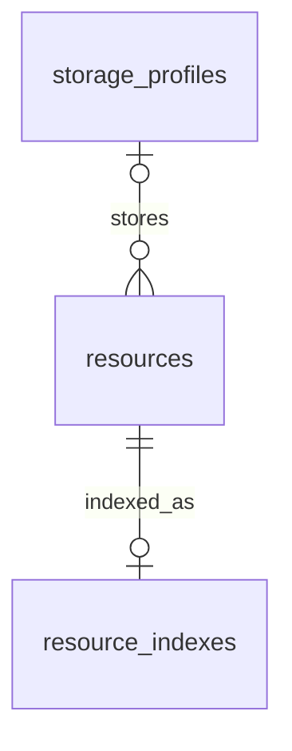

# 数据库 Schema

表结构定义位于 [SQLAlchemy ORM 模型](../mmkb/db/models.py)，初始结构和后续变更通过 [Alembic 迁移](../migrations/versions/0001_initial_schema.py) 管理。业务表使用 `mmkb` schema，迁移版本记录保存在 `public.mmkb_alembic_version`。

## `resources`

| 字段 | 类型 | 用途 |
| --- | --- | --- |
| `id` | UUID | 资料主键 |
| `input_kind` | text | 输入形式：`image / text_image / text` |
| `workflow` | text，可空 | 处理路线，尚未路由时为空 |
| `title` | text | 资料标题 |
| `tags` | text[] | 分类和标签 |
| `user_text` | text，可空 | 用户文字或配文 |
| `caption` | text，可空 | 图片描述 |
| `ocr_text` | text，可空 | OCR 全文 |
| `extra` | JSONB | 宽高、文件大小、MIME、来源等附加信息 |
| `storage_profile_id` | UUID，可空 | 文件所属存储配置的外键 |
| `object_key` | text，可空 | 相对文件 key |
| `sha256` | text，可空 | 文件内容校验值 |
| `status` | text | 处理状态，默认 `pending` |
| `error` | text，可空 | 最近一次处理或清理错误 |
| `revision` | integer | 更新计数，默认 1 |
| `created_at` | timestamptz | 创建时间 |
| `updated_at` | timestamptz | 最后更新时间 |
| `deleted_at` | timestamptz，可空 | 逻辑删除时间 |

应用约定的工作流标识为 `structured_image / visual_image / visdoc / text_image / text`，处理状态为 `pending / processing / ready / failed`。这些取值以及输入组合、路径边界和更新计数需要由应用校验，数据库不设置相应业务 CHECK。

## `resource_indexes`

| 字段 | 类型 | 用途 |
| --- | --- | --- |
| `resource_id` | UUID | 主键兼外键，每份资料最多一条检索记录 |
| `embedding` | halfvec(2048) | 整份资料的半精度多模态向量 |
| `segmented_text` | text | 应用分词后以空格连接的辅助检索文本 |
| `search_tsv` | tsvector | 根据分词文本自动生成的 STORED 列 |
| `indexed_at` | timestamptz | 索引写入时间 |

`search_tsv` 使用 PostgreSQL `simple` 配置。向量编码模型由部署环境指定；查询与资料必须遵守相同编码约定。改变模型或关键预处理需要重建已有向量，改变维度还需要结构迁移。

## `import_items`

`0002_import_items` 新增逐项导入回执。主键 `key` 是客户端提交 UUID；`request_hash` 绑定规范化内容与参数，`sha256` 保存原件摘要。`planned_resource_id/storage_profile/object_key` 在写原件前持久保存，`resource_id/state/outcome/duplicate/error` 记录结果，`created_at/updated_at` 记录时间。

该表保留资源删除后的幂等记录，因此不对资源建立级联删除外键；存储快照只包含公共位置及凭证引用，不包含密钥。`reserved/completed/failed` 是上传阶段状态，与资源表的模型处理状态分开。详见 [批量导入协议与恢复边界](imports.md)。

## `storage_profiles`

| 字段 | 类型 | 用途 |
| --- | --- | --- |
| `id` | UUID | 存储配置主键 |
| `name` | text，唯一 | 配置名称 |
| `backend` | text | 应用使用 `local / s3` |
| `local_root` | text，可空 | 本地根目录 |
| `endpoint_url` | text，可空 | S3 兼容 API 地址 |
| `bucket` | text，可空 | Bucket 名称 |
| `credential_ref` | text，可空 | 服务端凭证配置引用，不保存密钥值 |

具体服务地址、路径、Bucket 与凭证由部署环境提供，公开代码不绑定某个存储实例。

## 约束、索引与注释

- 三张表保留主键及必要字段的 NOT NULL。
- `resources.storage_profile_id` 引用存储配置，存在引用时禁止删除配置。
- `resource_indexes.resource_id` 引用资料，物理删除资料时级联删除检索记录。
- 存储配置名称、资源的 `(storage_profile_id, object_key)` 分别唯一。
- 显式索引包括向量 cosine HNSW、待处理资料和 SHA-256 的 B-tree；初始不建 GIN。
- 三张表及全部 30 个字段使用 SQLAlchemy `comment=` 定义数据库注释，由 Alembic 写入。

`revision`、更新时间和软删除过滤由资源服务显式维护，接口与状态规则见 [资源管理说明](resources.md)。JSONB/ARRAY 更新应整体赋值或显式标记变化，不能假定嵌套对象的原地修改会自动持久化。

## 结构管理

`migrations/env.py` 以 `Base.metadata` 为目标，仅比较业务 schema。表和索引使用 Alembic 结构化操作，schema 创建和删除使用 SQLAlchemy 的 DDL 对象。pgvector 扩展属于数据库部署前置依赖，业务回滚不删除该扩展。

开发、迁移和测试统一使用 `mmkb` Conda 环境，执行命令前先运行 `conda activate mmkb`。通过 `alembic upgrade head` 初始化或升级，不在应用启动时调用 `create_all()` 绕过迁移历史。自动生成的候选迁移需经过检查；历史迁移保留生成时的定义，不导入可能变化的运行时 ORM。命令和环境配置见 [README](../README.md)。
